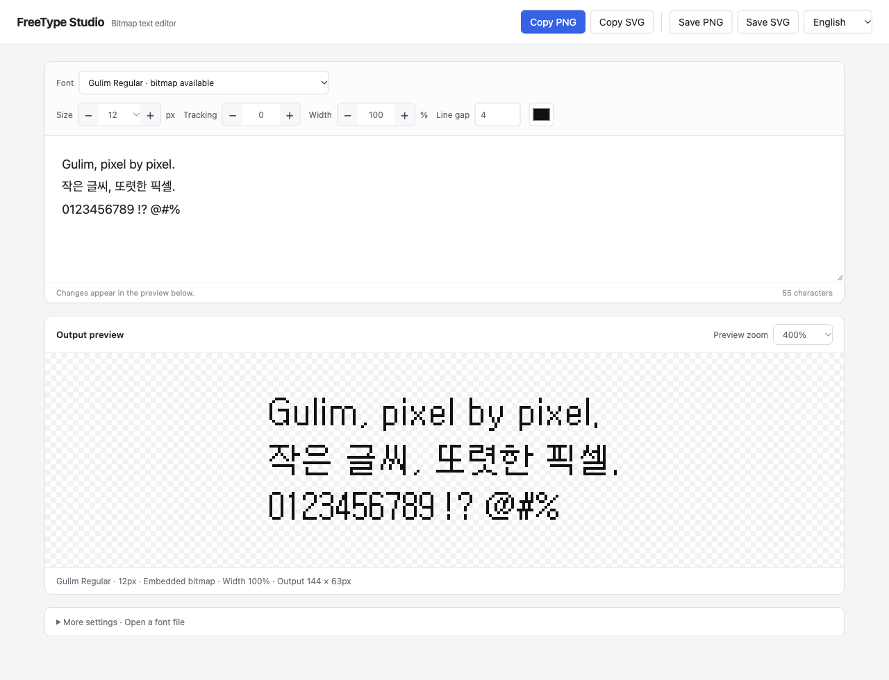

<div align="center">

# FreeType Studio

**The tiny bitmap Gulim I wanted on my Mac.**

A local text editor for embedded bitmap fonts, with PNG and SVG clipboard export.

**English** · [한국어](README.ko.md)

[Quick start](#quick-start) · [Why this exists](#why-this-exists) · [Using the editor](#using-the-editor) · [Related tools](#related-tools)


</div>



## Why this exists

I wanted to use **Gulim's tiny, pixel-sharp bitmap text on my Mac**. The bitmap was already inside the font file. Getting those exact pixels into a design was the frustrating part.

Gulim is a Korean typeface that can contain separate bitmap drawings for particular small sizes, alongside its scalable outlines. Installing the font and selecting a small text size in a Mac app does not give you an explicit control for choosing those embedded bitmaps. The workflow I wanted was simple: **choose the real bitmap size, type some text, adjust the spacing, and paste the result into a design.**

FreeType already provides the bitmap-loading functionality. FreeType Studio puts a small, familiar interface around it. It reads the embedded bitmap directly and exports the result as PNG or pixel-shaped SVG artwork.

This is a tool for making artwork on a Mac. It does **not** change how other macOS apps render text, and it does not claim that macOS is incapable of displaying every kind of bitmap font.

## Quick start

### 1. Check the requirements

- **macOS** and **Python 3.9 or newer**.
- **Git** to clone the repository. Alternatively, use GitHub's **Code → Download ZIP** and extract it.
- **Xcode Command Line Tools**, including Swift, for SVG clipboard copying. PNG copying and file exports do not use Swift.
- A font you are allowed to use. **No commercial font files are bundled.**

If Git, Python or Swift is missing, open Terminal and run:

```sh
xcode-select --install
```

Follow Apple's installer. If you still need Python, install a macOS version from [python.org](https://www.python.org/downloads/macos/).

### 2. Install and launch

```sh
git clone https://github.com/minmin416/freetype-studio.git
cd freetype-studio
./Setup.command
./Start.command
```

If you downloaded the ZIP, open Terminal in the extracted folder and run `./Setup.command`, then `./Start.command`.

Your browser opens **[http://127.0.0.1:8791](http://127.0.0.1:8791)**. No account, API key or frontend build step is needed. The setup script creates a local Python virtual environment and installs the dependencies.

For later launches, double-click **Start.command** in Finder. Keep the project folder in place. To stop the server, find the process listening on port 8791 with `lsof -nP -iTCP:8791 -sTCP:LISTEN` and stop that process in Terminal or Activity Monitor; closing the browser tab leaves the server running.

**The interface supports English and Korean.** It follows your browser language on first use; use the language menu at the top right to switch. Your choice is remembered.

### 3. Open a font

If Microsoft Word is installed, the app first checks its resources for `gulim.ttc` and `batang.ttc`. It also searches your user font directory and selected macOS font directories.

Otherwise, expand **More settings → Open a font file** and choose a local TTF, TTC, OTF or supported bitmap font. Fonts with embedded bitmap sizes are marked **bitmap available**. Select one and leave **Rendering** set to **Embedded bitmap**.

The local Gulim file used for testing contains **11–25px** bitmap sizes. Other font versions may contain different sizes, or no bitmaps at all. A font that looks pixelated is not necessarily a font with embedded bitmap data.

For a quick check without Gulim, open [`tests/fixtures/tiny.bdf`](tests/fixtures/tiny.bdf), the project's own minimal bitmap font, and type **AB AB**. This fixture only contains `A`, `B` and a space.

## Features

|                                  |                                                                                 |
| :------------------------------- | :------------------------------------------------------------------------------ |
| **Actual embedded bitmaps**      | Select the bitmap sizes stored inside the font, with no silent outline fallback |
| **Simple text controls**         | Font, size, tracking, extra line gap, color and horizontal width                |
| **Copy or save**                 | PNG images and SVG pixel shapes, on the clipboard or as files                   |
| **Pixel-preserving enlargement** | Integer export scales and a transparent background                              |
| **Local fonts**                  | Discover installed fonts or open a font file directly                           |
| **Remembered input**             | Restore your text and settings after a page reload                              |

## Using the editor

1. Select a font and type in the large text field.
2. Use **− / +** next to **Size**, **Tracking** and **Width**. Numeric fields also accept direct input.
3. Check **Output preview**, which shows the actual rendered result.
4. Click **Copy PNG** or **Copy SVG**, then paste into another app. Use **Save PNG / Save SVG** when you need a file.

### Size, width and scale

| Setting           | What it changes                                                                       |
| :---------------- | :------------------------------------------------------------------------------------ |
| **Size · px**     | The bitmap strike to load. Embedded bitmap mode only offers sizes present in the font |
| **Tracking · px** | Additional space between characters                                                   |
| **Line gap · px** | Extra space between lines                                                             |
| **Width · %**     | Horizontal compression or stretching. **100%** preserves the original width           |
| **Export scale**  | The size of copied and saved output, enlarged by an integer factor                    |
| **Preview zoom**  | Onscreen magnification only; it does not change export size                           |

Width adjustments can change the strokes. For the original bitmap at its original pixel size, use **Width 100%** and **Export scale 1×**. You can enlarge the preview independently.

### How SVG export works

SVG stores the pixels as **vector rectangles**, rather than editable text or embedded font data. The receiving computer does not need the original font to display the artwork.

SVG copying places both an SVG image and SVG source text on the macOS clipboard. Depending on the receiving app, pasting may insert artwork or source code. If an app expects a file import, use **Save SVG** instead. PNG copying places a PNG image on the clipboard.

## Limitations and local storage

- This is a **macOS local tool**, not a hosted service or a font editor.
- Missing bitmap sizes or characters produce an error. Embedded bitmap mode does not quietly substitute outlines.
- Fonts without embedded bitmaps can use **More settings → Rendering → Outline → monochrome pixels**. This is explicitly identified as outline rendering.
- Complex-script shaping, bidirectional text and professional typesetting are not supported.
- Input and settings are stored in your browser's local storage. Fonts you open are copied to the project's local `fonts/` folder. They are not uploaded to an external service.
- Clipboard behavior varies between receiving apps. PNG/SVG copy and download paths have been checked locally on macOS; app-by-app paste compatibility is not guaranteed.

## Related tools

Embedded bitmap extraction already exists. This project's focus is a short **type → adjust → copy artwork** workflow, built on FreeType.

- **[FreeType](https://freetype.org/freetype2/docs/reference/ft2-glyph_retrieval.html)** provides the embedded-bitmap loading used here through [freetype-py](https://github.com/rougier/freetype-py).
- **[monobit](https://github.com/robhagemans/monobit)** is a bitmap-font toolkit that supports extracting embedded bitmaps from TrueType/OpenType fonts and font collections, along with rendering and format conversion.
- **[FontForge](https://fontforge.org/docs/ui/menus/filemenu.html)** can load embedded bitmap strikes for editing. Its [scripting API](https://fontforge.org/docs/scripting/scripting-alpha.html#Export) can export bitmap glyphs as PNG.

Those tools may fit better if you want font conversion, extraction pipelines or glyph editing. FreeType Studio is a small interface for composing a piece of text and copying it as an image or SVG.

## Development

The backend uses Python's standard HTTP server, [freetype-py](https://github.com/rougier/freetype-py) and [Pillow](https://python-pillow.org/). The interface is plain HTML, CSS and JavaScript. A small Swift script handles SVG clipboard copying.

```sh
.venv/bin/python -m unittest discover -s tests -v
```

Report bugs or ideas through [Issues](https://github.com/minmin416/freetype-studio/issues). Include your font name, selected size and a short sample of the text that triggers the problem. Please do not attach font files you do not have permission to distribute.

## License

The code is released under the [MIT License](LICENSE). FreeType, freetype-py, Pillow and any fonts you use retain their own licenses. This is an independent project, not an official FreeType application.
