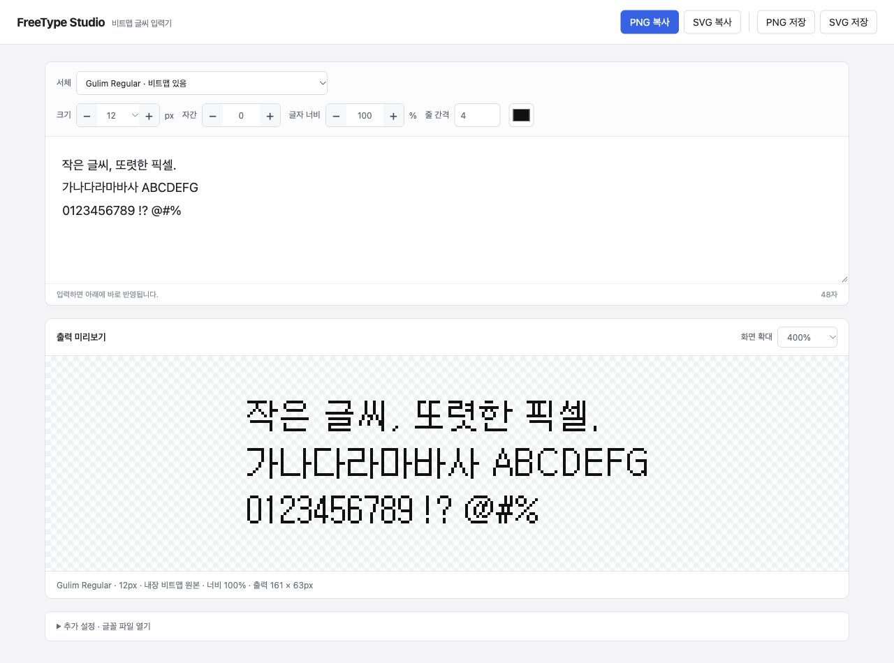

<div align="center">

# FreeType Studio

**작은 글씨의 픽셀까지, 그대로.**

A local bitmap type playground for macOS.

[시작하기](#시작하기) · [기능](#기능) · [사용법](#사용법) · [제약 사항](#알아두기)


</div>



굴림의 작은 글씨에는 그 크기를 위해 따로 그려진 비트맵이 들어 있습니다. FreeType Studio는 글꼴 파일 속 비트맵을 직접 읽어, macOS에서도 그 픽셀을 조절하고 꺼내 쓸 수 있게 만든 작은 도구입니다.

입력하고, 간격을 맞추고, PNG나 SVG로 복사하세요. 모든 처리는 내 컴퓨터에서 이루어집니다.

## 기능

|                 |                                                                 |
| :-------------- | :-------------------------------------------------------------- |
| **내장 비트맵** | 글꼴에 들어 있는 실제 비트맵 크기를 선택하고 원본 픽셀로 렌더링 |
| **간단한 편집** | 서체, 크기, 자간, 줄 간격, 색상과 글자 너비 조절                |
| **복사와 저장** | PNG 이미지와 SVG 도형을 클립보드로 복사하거나 파일로 저장       |
| **픽셀 확대**   | 정수 배율 확대와 투명 배경 지원                                 |
| **로컬 글꼴**   | 설치된 글꼴 검색, TTF·TTC·OTF 등 글꼴 파일 직접 열기            |
| **입력 유지**   | 새로고침해도 입력 내용과 설정 복원                              |

## 시작하기

**macOS · Python 3.9 이상**이 필요합니다. SVG 클립보드 복사에는 Swift가 포함된 **Xcode Command Line Tools**가 필요합니다.

```sh
git clone https://github.com/minmin416/freetype-studio.git
cd freetype-studio
./Setup.command
./Start.command
```

브라우저에서 **[127.0.0.1:8791](http://127.0.0.1:8791)** 이 열립니다. 이후에는 `Start.command`를 더블클릭하면 됩니다. 이 도구는 로컬 서버로 실행되며, 별도의 계정이나 API 키가 필요하지 않습니다.

<details>
<summary>Python 또는 Swift가 없다고 나올 때</summary>

터미널에서 아래 명령으로 Apple의 개발 도구 설치 화면을 열 수 있습니다.

```sh
xcode-select --install
```

설치한 뒤 `./Setup.command`를 다시 실행하세요. Python이 별도로 필요하면 [python.org](https://www.python.org/downloads/macos/)에서 macOS용 Python을 설치할 수 있습니다.

</details>

### 굴림 글꼴 준비

Microsoft Word가 설치되어 있으면 앱 안의 `gulim.ttc`와 `batang.ttc`를 우선 검색합니다. 사용자 글꼴 폴더와 macOS의 일부 시스템 글꼴 폴더도 읽습니다.

목록에 원하는 글꼴이 없다면 **추가 설정 → 글꼴 파일 열기**에서 직접 추가하세요. 내장 비트맵이 있는 글꼴은 목록에 표시됩니다. Word에 포함된 로컬 굴림 파일에서 **11~25px** 비트맵을 확인했으며, 다른 버전의 글꼴은 제공하는 크기가 다를 수 있습니다.

**이 저장소에는 글꼴 파일을 포함하지 않습니다.** 사용할 권한이 있는 글꼴을 준비해주세요.

## 사용법

1. 서체를 고르고 입력창에 글을 씁니다.
2. 크기·자간 옆의 **− / +** 버튼으로 조절합니다. 숫자 입력란은 직접 수정할 수도 있습니다.
3. 아래 미리보기에서 실제 출력 결과를 확인합니다.
4. **PNG 복사 / SVG 복사**를 누르고 원하는 앱에 붙여넣습니다. 파일이 필요하면 **저장**을 누릅니다.

### 크기와 배율

| 설정              | 바뀌는 것                                                         |
| :---------------- | :---------------------------------------------------------------- |
| **크기 · px**     | 글꼴에서 사용할 비트맵 크기. 내장된 크기만 선택 가능              |
| **글자 너비 · %** | 가로 비율. 100%가 원본이며, 다른 값은 픽셀을 가로로 늘리거나 줄임 |
| **출력 배율**     | 복사·저장되는 이미지의 크기. 픽셀 경계를 유지하는 정수 배율       |
| **화면 확대**     | 미리보기 배율. 복사·저장 크기에는 영향 없음                       |

너비 변형은 획의 모양을 바꿀 수 있습니다. 원본 비트맵을 그대로 사용하려면 **글자 너비 100%, 출력 배율 1×**로 두세요.

### SVG는 어떻게 나오나요?

SVG는 글꼴 파일이나 편집 가능한 텍스트를 포함하지 않고, **각 픽셀을 벡터 도형으로 저장**합니다. 다른 컴퓨터에 같은 글꼴이 없어도 모양이 유지됩니다.

SVG 복사는 macOS 클립보드에 SVG 이미지와 SVG 원문을 함께 넣습니다. 붙여넣는 앱의 지원 방식에 따라 이미지 또는 코드로 붙을 수 있습니다. 파일 가져오기가 필요한 앱에서는 **SVG 저장**을 사용하세요.

## 알아두기

- **macOS용 로컬 도구**입니다. 호스팅 서비스나 범용 글꼴 편집기는 아닙니다.
- 글꼴에 해당 크기의 비트맵이나 입력한 글자가 없으면 오류를 표시합니다. 내장 비트맵 모드에서 외곽선으로 자동 대체하지 않습니다.
- 내장 비트맵이 없는 글꼴은 추가 설정의 **외곽선 → 흑백 픽셀** 모드로 사용할 수 있습니다. 이 결과는 내장 비트맵과 구분됩니다.
- 복잡한 문자 조합, 양방향 텍스트와 전문적인 조판은 지원하지 않습니다.
- 입력 내용과 설정은 브라우저의 로컬 저장소에 남습니다. 직접 추가한 글꼴은 프로젝트의 `fonts/` 폴더에 저장됩니다.
- PNG·SVG 복사와 파일 저장은 로컬 macOS에서 확인했습니다. 디자인 앱별 붙여넣기 호환성은 다를 수 있습니다.

## 개발

서버는 Python 표준 라이브러리의 HTTP 서버와 [freetype-py](https://github.com/rougier/freetype-py), [Pillow](https://python-pillow.org/)를 사용합니다. 화면은 HTML·CSS·JavaScript이며 빌드 과정이 없습니다. SVG 클립보드 처리는 작은 Swift 스크립트가 담당합니다.

```sh
.venv/bin/python -m unittest discover -s tests -v
```

문제나 개선 아이디어는 [Issues](https://github.com/minmin416/freetype-studio/issues)에 남겨주세요. 재현할 때 사용한 글꼴 이름·크기·입력 문자를 함께 적어주시면 도움이 됩니다. 배포 권한이 없는 글꼴 파일은 첨부하지 말아주세요.

## 라이선스

코드는 [MIT License](LICENSE)로 배포합니다. FreeType·freetype-py·Pillow와 사용하는 글꼴은 각자의 라이선스를 따릅니다. 이 프로젝트는 FreeType 프로젝트와 별개로 만든 도구입니다.
